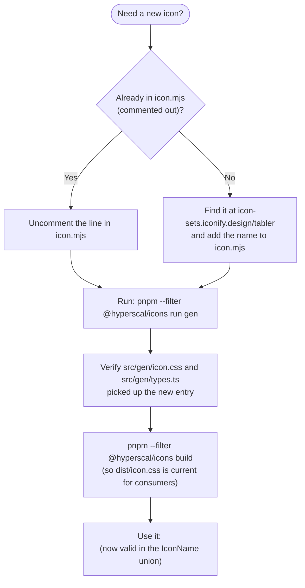

# @hyperscal/icons — Developer Guide

> How to consume this package and how to contribute to it.
> For API details see `API.md`. For internal architecture see `INTERNALS.md`.

**Status:** draft · **Package:** `packages/internal/icons` · **Updated:** 2026-07-02

## Installation & setup

```jsonc
// package.json of the consuming app/package
"dependencies": {
  "@hyperscal/icons": "workspace:*"
}
```

**Peer dependency:** `react` (`>=15.6.1`).

**Import the stylesheet once, globally**, in your app's root/entry file —
without it, `Icon` renders an empty element (the class name resolves to
nothing):

```tsx
// app root (e.g. root.tsx, main.tsx)
import "@hyperscal/icons/icon.css";
```

**Dev-server gotcha:** `@hyperscal/icons/icon.css` only exists in
`dist/icon.css` (generated, then copied there at build time) — it is
**not** resolvable from `src/` in dev the way the package's JS is. If
you're setting up a new app/Vite config, alias it explicitly:

```ts
// vite.config.ts
resolve: {
  alias: {
    "@hyperscal/icons/icon.css": path.resolve(__dirname, "../../packages/internal/icons/dist/icon.css"),
  },
},
```

(Copy this from `e2e/vite.config.ts` or `apps/admin/vite.config.ts`
— both already have it.) Practically, this means you need to have run
`pnpm build` (or at least `pnpm run gen` + the CSS copy step) for this
package at least once before the stylesheet resolves.

## Common usage patterns

### 1. Render an icon

```tsx
import { Icon } from "@hyperscal/icons";

<Icon name="user" />
<Icon name="settings" enlarged aria-label="Settings" />
<Icon as="span" name="chevron-down" className="text-neutral-500" />
```

### 2. Reference icon names without pulling in the component

```tsx
import type { IconName, icons } from "@hyperscal/icons/icons";

// e.g. populating a ComboBox of icon choices (see apps/docs' combobox stories)
const options: IconName[] = icons.filter((n) => n.startsWith("arrow-"));
```

## How to add a new icon



1. Find the icon at [icon-sets.iconify.design/tabler](https://icon-sets.iconify.design/tabler/).
2. In `icon.mjs`, uncomment the matching line (or add it if it's not
   present — the file was originally seeded from the full Tabler catalogue,
   so most icons are already there, commented out).
3. Run `pnpm --filter @hyperscal/icons run gen` — regenerates
   `src/gen/icon.css` and `src/gen/types.ts`.
4. Run a build (or your dev server's watch mode) so `dist/icon.css` picks
   up the change for anyone consuming the built output.
5. Use `<Icon name="the-new-name" />` — it's now a valid `IconName`.

Commit the `icon.mjs` change together with the regenerated
`src/gen/*`/`dist/*` output in the same PR (the repo's git history shows
this as the established pattern — small, focused "add icon" commits).

**Don't** hand-edit `src/gen/icon.css` or `src/gen/types.ts` — they're
regenerated and any manual edit is silently lost on the next `gen` run.

## Gotchas

- **`icon.css` resolves differently in dev vs. from a fresh checkout** — see
  Installation & setup. If icons render as blank boxes/nothing, check
  whether the stylesheet is actually loaded before assuming the icon name
  is wrong.
- **No runtime fallback for a bad `name`.** TypeScript catches most typos
  (the `IconName` union), but anything that bypasses the type check (an
  `as any` cast, a dynamically-constructed name) renders nothing, silently
  — no console warning, no fallback glyph.
- **`enlarged` leaks onto the DOM element** as a literal attribute (see
  [[icons-internals]]) — harmless today, but don't build new logic that
  depends on `enlarged` _not_ being present in the rendered element's
  attributes.
- **`customIcons` prop does nothing** — if you find yourself wanting to
  pass custom icon data, this isn't a wired-up extension point today; check
  with the package owner before assuming otherwise.

## What not to do

- **Don't import `lucide-react` icons directly in new code** — use `Icon`
  from this package instead; `@hyperscal/icons` is the sanctioned
  replacement (see [[icons-intent]]). If the icon you need isn't in the
  curated Tabler set, add it via the workflow above rather than reaching
  for a different icon library.
- **Don't hand-edit generated files** (`src/gen/icon.css`, `src/gen/types.ts`)
  — always go through `icon.mjs` + `pnpm run gen`.
- **Don't bulk-read `icon.css`** if you're exploring this package with an
  AI assistant or in a large diff review — it's ~1,000 lines of generated
  CSS with no per-line meaning beyond "one rule per icon."
- **Don't assume every Tabler icon is available** — only what's uncommented
  in `icon.mjs` typechecks as a valid `name`.

## Related packages

| Package         | Relationship                                                                                                                                                                          |
| --------------- | ------------------------------------------------------------------------------------------------------------------------------------------------------------------------------------- |
| `@hyperscal/ui` | The primary consumer — its deprecated `legacy-icons` atom is the pre-`@hyperscal/icons` approach this package replaced; ~95 files in `@hyperscal/ui` already import `Icon` from here. |
| `apps/docs`     | Uses the `@hyperscal/icons/icons` subpath (name list without the component) to populate an icon-picker `ComboBox` in Storybook.                                                       |

## Links

- **Intent:** [[icons-intent]]
- **API:** [[icons-api]] · **Internals:** [[icons-internals]]
- **Source:** `packages/internal/icons/src/`
