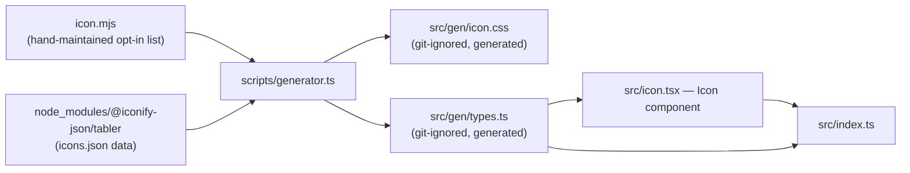

# @hyperscal/icons — Internals

> How the package works inside. Audience: contributors, not consumers.
> Assumes you have read `API.md`.

**Status:** draft · **Package:** `packages/internal/icons` · **Updated:** 2026-07-02

## Internal architecture

| File                   | Role                                                                                                                                                                                                                                  |
| ---------------------- | ------------------------------------------------------------------------------------------------------------------------------------------------------------------------------------------------------------------------------------- |
| `icon.mjs`             | The **source of truth for which icons exist** — 5,996 lines, almost entirely commented-out Tabler icon names; a contributor uncomments the ones they want. Not generated; hand-maintained.                                            |
| `scripts/generator.ts` | Reads `icon.mjs`'s active (uncommented) entries + `@iconify-json/tabler`'s icon data, emits `src/gen/icon.css` and `src/gen/types.ts`. Also _computes_ an SVG sprite (`generateSprite`) that is never written — see Design tradeoffs. |
| `src/gen/icon.css`     | Generated CSS — one `.i-{name}` rule per opted-in icon (via `@iconify/utils`'s `getIconsCSS`). ~1,000 lines for the current opt-in set.                                                                                               |
| `src/gen/types.ts`     | Generated — the `icons` const array and derived `IconName` union type.                                                                                                                                                                |
| `src/icon.tsx`         | The `Icon` component — 28 lines, the only runtime logic in the package.                                                                                                                                                               |
| `src/index.ts`         | Barrel — re-exports `Icon` and `IconName`.                                                                                                                                                                                            |
| `tests/icon.test.tsx`  | Two tests: default `as="i"` rendering, and `as="span"` override. No coverage of `enlarged`/`customIcons` (see Known technical debt).                                                                                                  |

## Key abstractions

- **Opt-in codegen, not full-catalogue vendoring.** The three-stage
  pipeline (hand-edit `icon.mjs` → run `gen` → commit the generated output)
  is the entire "add an icon" workflow — there's no runtime icon lookup or
  dynamic loading; every available icon is baked into the build.
- **CSS-class icons instead of per-icon components.** `Icon` doesn't render
  SVG markup itself — it renders a plain element (`<i>` by default) with a
  generated class name, and the actual glyph comes from the imported
  `icon.css` (a `content`/`mask`/`background` CSS technique via Iconify's
  `getIconsCSS`, not read directly in this pass — see `@iconify/utils`'s
  own docs if extending the CSS generation).

## Design tradeoffs

- **SVG sprite generation is fully implemented but dead.**
  `generator.ts`'s `generateSprite()` builds a complete `<svg><defs>` sprite
  from the same icon set, but its result (`_sprite`) is never passed to
  `writer(...)` — only CSS and types get written. This looks like an
  abandoned alternative delivery mechanism, not a supported fallback.
  _(observed — see [[icons-intent]])_
- **`enlarged` isn't excluded from the `...props` spread.** `src/icon.tsx`
  destructures `as`, `name`, `className`, `customIcons` but not `enlarged`,
  so `enlarged` both drives the `text-[1.6em]` className logic _and_ gets
  spread onto the rendered element as a literal (non-DOM-standard)
  attribute. Small, low-impact, but real. _(observed)_
- **`customIcons` is accepted and silently discarded.** Destructured out
  (so at least it doesn't leak to the DOM the way `enlarged` does) but
  never read. Not part of `IconProps`'s declared type either — likely a
  vestige of a removed or never-finished feature (e.g. a planned custom
  icon registry). _(observed)_
- **No runtime validation of `name`.** Type safety is compile-time only
  (the `IconName` union); if a `name` somehow reaches runtime that isn't in
  the generated CSS (e.g. via an `as any` cast), the icon just silently
  renders no glyph — no error, no fallback icon. _(observed)_

## Dependencies

| Dependency                               | Type              | Why                                                                                                                                                                                          |
| ---------------------------------------- | ----------------- | -------------------------------------------------------------------------------------------------------------------------------------------------------------------------------------------- |
| `react`                                  | peer (`>=15.6.1`) | `Icon` is a React component.                                                                                                                                                                 |
| `@iconify-json/tabler`, `@iconify/utils` | dev only          | Only used by `scripts/generator.ts` at codegen time — not a runtime dependency of the built package at all.                                                                                  |
| `tsx`                                    | dev               | Runs `scripts/generator.ts` (`pnpm run gen`) — a TS script executed directly, not compiled first.                                                                                            |
| `copy-files-from-to`                     | dev               | Copies `src/gen/icon.css` → `dist/icon.css` as part of `pnpm build` (declared in `package.json`'s `copyFiles`) — the step that makes the dist-only `icon.css` export resolvable.             |
| `tsdown`                                 | dev               | Build — two entries (`index`, `icons` → `src/gen/types.ts`), `platform: "neutral"`, `dts: false` (separate `tsc` pass emits declarations, same two-stage shape as several sibling packages). |

## Known technical debt

Recorded in [[icons-debt]] (`docs/DEBT.md`), created by the 2026-07-03 bug
hunt. The four items previously listed here (the `enlarged` DOM leak, the
dead `customIcons` prop, the unused `generateSprite()`, and the missing
runtime fallback for an invalid icon name) moved there with IDs and
verification evidence, joined by one **medium** generator-pipeline finding
(ERR-1): icon-existence validation is accidental — the dead sprite code's
unhandled rejection is the only thing that fails `pnpm gen` on a bad
`icon.mjs` name, so deleting it without a replacement check would let a
typo'd icon typecheck and render blank.

## Superseded

- _(none yet)_

## Links

- **Intent:** [[icons-intent]]
- **API:** [[icons-api]]
- **Guide:** [[icons-guide]]
- **Source:** `packages/internal/icons/src/`
