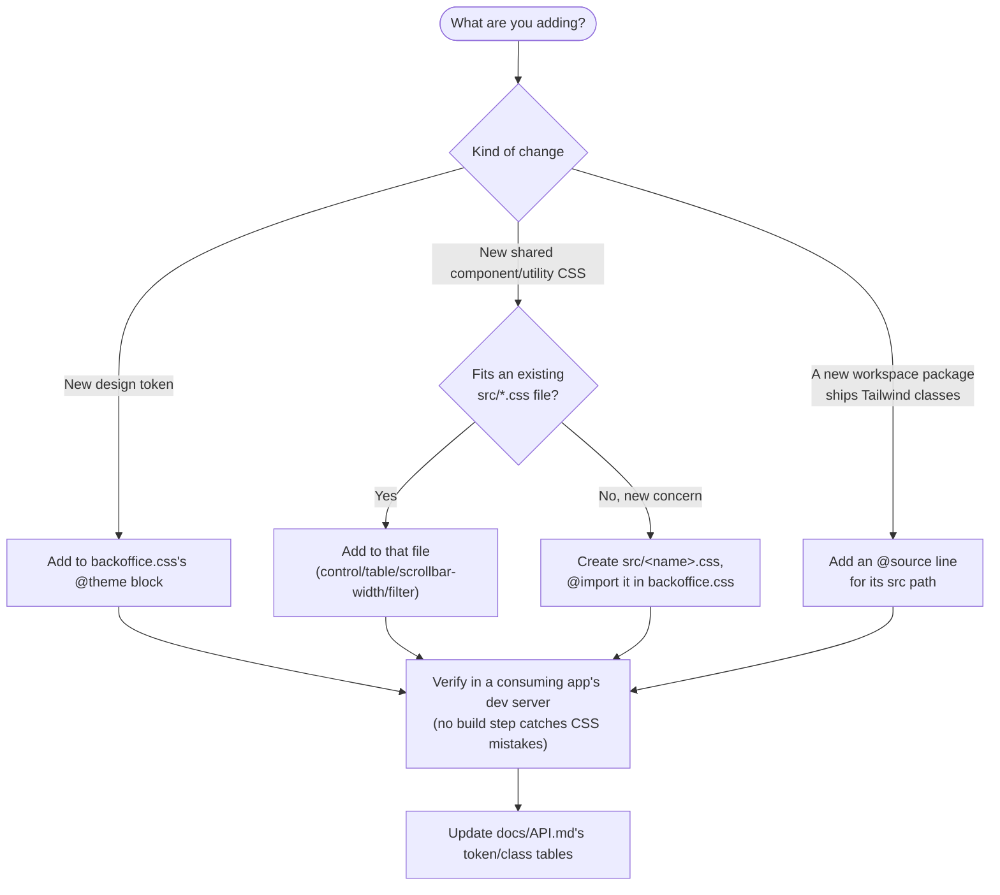

# @hyperscal/tailwind-config — Developer Guide

> How to consume this package and how to contribute to it.
> For API details see `API.md`. For internal architecture see `INTERNALS.md`.

**Status:** draft · **Package:** `packages/tailwind-config` · **Updated:** 2026-07-02

## Installation & setup

```jsonc
// package.json of a consuming app
"dependencies": {
  "@hyperscal/tailwind-config": "workspace:*"
}
```

Import the stylesheet **once**, in your app's root/entry file:

```ts
import "@hyperscal/tailwind-config/backoffice.css";
```

Use the `@tailwindcss/vite` plugin in your `vite.config.ts` (the pattern
every current consumer uses — this package's own `postcss.config.js` is
dead, don't wire up PostCSS instead):

```ts
import tailwindcss from "@tailwindcss/vite";

export default defineConfig({
  plugins: [tailwindcss() /* ... */],
});
```

If your app's Vite/build setup can't resolve deep-imported CSS from a
workspace package by default, alias it explicitly (see
`@hyperscal/icons`'s [[icons-guide]] for the equivalent pattern with that
package).

## Common usage patterns

### 1. Use design tokens via Tailwind utility classes

```tsx
<div className="bg-primary-500 rounded-md p-4 text-white">...</div>
```

### 2. Reference a token directly in custom CSS

```css
.my-custom-thing {
  border-color: var(--color-neutral-70);
}
```

### 3. Use the shared sizing system instead of hardcoding pixel values

```tsx
<button className="button-md">Save</button>
```

Prefer `control-*`/`button-*`/`icon-*` classes over ad-hoc padding/sizing
when building a new form control — they stay proportional if
`--padding-ratio` or the base spacing tokens ever change.

## How to add to this package



1. **New design token** → add it to `backoffice.css`'s `@theme` block,
   following the existing `--color-{name}-{20..1000}` + bare-name-alias
   pattern for color scales.
2. **New shared component/utility CSS** → extend an existing `src/*.css`
   partial if it fits (`control.css` for sizing, `table.css` for table
   styling, etc.), or create a new `src/<name>.css` and add an `@import` for
   it in `backoffice.css`.
3. **A new workspace package that ships Tailwind classes** → add an
   `@source "../<path>/src/**/*.{ts,tsx}"` line — otherwise its components
   render unstyled in every consuming app, silently (no build error).
4. **No test suite, no typecheck for CSS** — verify changes visually in a
   consuming app's dev server (or Storybook). Update `docs/API.md`'s token
   and utility-class tables so the doc doesn't drift from the CSS.

**Don't** add to `global.css` or `postcss.config.js` — both are dead (see
[[tailwind-config-intent]]); anything you add there won't reach any
consumer.

## Gotchas

- **Adding a package without adding its `@source` line is the single most
  common way to silently break styling** — the failure mode is unstyled
  components, not a build error. If a new package's UI looks broken after
  integration, check `@source` first.
- **The `../core` `@source` line is stale** (points at a deleted package,
  `packages/core`) — don't use it as a template for a new `@source` entry;
  copy one of the still-live ones instead.
- **Three neutral-palette color blocks exist in `@theme`, only one active**
  — if you're changing the neutral palette, you're commenting/uncommenting
  blocks by hand, not passing a config value. Double-check which block is
  active (`[ACTIVE]` label in the source comment) before assuming your
  edit took effect.
- **`global.css` looks like it should be safe "extra" CSS to import if you
  need something from it — it isn't.** It defines some of the same class
  names as `backoffice.css` with _different_ rules (see
  [[tailwind-config-internals]]). If you find yourself wanting something
  from `global.css`, port the specific rule into `backoffice.css`/a
  `src/*.css` partial instead of importing the whole file.
- **The Quill toolbar CSS block is duplicated within `backoffice.css`
  itself** — if you need to change Quill toolbar styling, check whether
  you're editing both copies or just one (see [[tailwind-config-internals]]).

## What not to do

- **Don't wire up `postcss.config.js`** — no current consumer uses it; all
  four apps use the `@tailwindcss/vite` plugin. If you think you need
  PostCSS, that's a signal to check why the Vite plugin isn't working for
  your case, not to route around it.
- **Don't re-import `global.css`** — it's superseded, defines
  conflicting/stale versions of some classes, and uses Tailwind v3 syntax
  incompatible with this package's v4 setup.
- **Don't add app-specific styling here** — this package is genuinely
  shared across every consumer; app-specific CSS belongs in that app.
- **Don't hardcode pixel values for control/button sizing** — use the
  `control-*`/`button-*`/`icon-*` classes so sizing stays derived from the
  shared spacing ratio.

## Related packages

| Package                                                                                                             | Relationship                                                                                                                       |
| ------------------------------------------------------------------------------------------------------------------- | ---------------------------------------------------------------------------------------------------------------------------------- |
| `@hyperscal/ui`, `@hyperscal/icons`, `@hyperscal/form`, `packages/dataview`, `packages/filters`, `packages/command` | Every package listed in `backoffice.css`'s `@source` — their Tailwind classes only render because this package scans their source. |
| `e2e`, `apps/admin`, `apps/crm/order-management`, `apps/docs`                                                   | The four real consumers, each importing `backoffice.css` once at their app root/entry.                                             |

## Links

- **Intent:** [[tailwind-config-intent]]
- **API:** [[tailwind-config-api]] · **Internals:** [[tailwind-config-internals]]
- **Source:** `packages/tailwind-config/backoffice.css`
