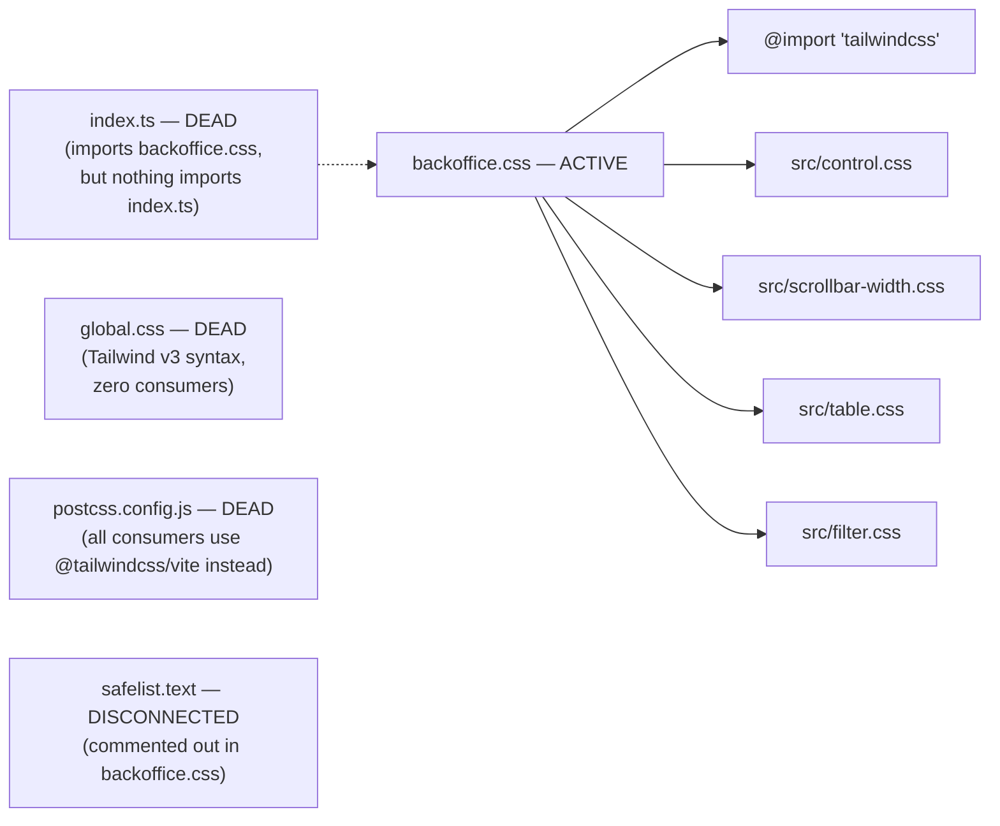

# @hyperscal/tailwind-config — Internals

> How the package works inside. Audience: contributors, not consumers.
> Assumes you have read `API.md`.

**Status:** draft · **Package:** `packages/tailwind-config` · **Updated:** 2026-07-02

## Internal architecture

| File                                 | Role                                                                                                                                                                    |
| ------------------------------------ | ----------------------------------------------------------------------------------------------------------------------------------------------------------------------- |
| `backoffice.css`                     | The one live entry point. `@theme` tokens + `@source` list + `@layer base`/`components` CSS, importing the four `src/*.css` partials.                                   |
| `src/control.css` (251 lines)        | The size-variant (`sm`/`md`/`lg`) control/button/icon/dropdown-image sizing system, derived from `--padding-ratio` (golden ratio).                                      |
| `src/table.css` (22 lines)           | `.active-row` table row highlighting.                                                                                                                                   |
| `src/scrollbar-width.css` (31 lines) | Cross-browser scrollbar utilities.                                                                                                                                      |
| `src/filter.css` (3 lines)           | One class, `.filter-popover-min-w`.                                                                                                                                     |
| `index.ts`                           | ⚠️ Dead — no consumer. Would be the bare-package-import entry point if `package.json` declared a `main`/`exports` pointing to it, but it doesn't.                       |
| `global.css`                         | ⚠️ Dead — the pre-Tailwind-v4-migration stylesheet (created at project init, per git history). Tailwind v3 `@tailwind` directive syntax; HSL-triplet custom properties. |
| `postcss.config.js`                  | ⚠️ Dead — all four real consumers use the `@tailwindcss/vite` plugin, not PostCSS.                                                                                      |
| `safelist.text`                      | Disconnected — referenced only by a commented-out `@source` line in `backoffice.css`.                                                                                   |

## Key abstractions

- **CSS-first Tailwind v4 config, not JS config.** There's no
  `tailwind.config.js` — theme tokens (`@theme`), content scanning
  (`@source`), and imports (`@import`) all live directly in `backoffice.css`
  per Tailwind v4's recommended approach. `global.css`'s `@tailwind
base/components/utilities;` directives are the old (v3) way, now dead —
  see [[tailwind-config-intent]].
- **Golden-ratio-derived sizing scale.** `--padding-ratio: 1.618` feeds
  `--spacing-{sm,md,lg}-ratio` (via `calc(1 / pow(1.618, n))` expressions in
  `@layer base`), which in turn drive every `control-*`/`button-*` sizing
  class in `src/control.css`. Changing `--padding-ratio` would cascade
  through the entire control-sizing system at once — a single knob for
  "make all form controls proportionally bigger/smaller."
- **Toggle-by-comment palette selection.** The `@theme` block's neutral
  color palette has three alternative definitions written as adjacent CSS
  blocks (true gray / plain slate / purple-tinted slate); only one is
  uncommented at a time, manually, by editing the file directly. There's no
  build-time or runtime switch — this is literally "comment out two of the
  three color blocks."

## Design tradeoffs

- **No `exports` map in `package.json`** — every file in the package is
  reachable by direct deep-import path. Looser than every sibling package
  (which all declare strict `exports` maps), but matches this package's
  actual usage pattern (consumers import `backoffice.css` by exact path,
  not through a JS entry point). _(observed)_
- **The Quill toolbar CSS block (`.ql-toolbar button`, `.ql-toolbar
select`, `.ql-active`, etc.) is duplicated verbatim, back-to-back, within
  `backoffice.css` itself** — same rules, same selectors, appearing twice
  in the same `@layer components` block (separated only by a comment
  labeling the second copy "Quill Editor Theming - RichText Component").
  Harmless (CSS is idempotent — the second copy just re-declares the same
  rules), but dead weight and a maintenance trap: editing one copy without
  the other silently reintroduces drift. _(observed)_
- **`global.css` and `backoffice.css` define some same-named classes with
  different rules** (e.g. `.selected-h-sm`, `.codemirror-readonly`) — not a
  live conflict today since `global.css` is unimported, but a landmine if
  anyone ever re-imports it expecting it to be harmless additive CSS.
  _(observed)_
- **Font `@import` is deliberately commented out.** `backoffice.css`'s
  Google Fonts `@import` for Rubik is commented out, while
  `--font-family: "Rubik"` stays active as a token. Not a gap: both
  `e2e/app/root.tsx` and `apps/admin/app/root.tsx` load Rubik
  themselves via `<link rel="preconnect">`/`<link>` tags in the document
  head instead — faster than a render-blocking CSS `@import`. `global.css`
  (dead) still has the CSS `@import` active, which is one more reason not
  to resurrect it as-is. _(confirmed)_

## Dependencies

| Dependency              | Type                                                          | Why                                                                                                                                                                                                                             |
| ----------------------- | ------------------------------------------------------------- | ------------------------------------------------------------------------------------------------------------------------------------------------------------------------------------------------------------------------------- |
| `tailwindcss`           | dev, imported via `@import "tailwindcss"` in `backoffice.css` | Tailwind v4 core.                                                                                                                                                                                                               |
| `tailwindcss-animate`   | dependency                                                    | Referenced as a Tailwind plugin/animation utility set (not directly imported in the files read — likely wired through Tailwind v4's plugin resolution rather than an explicit `@plugin` directive; not confirmed in this pass). |
| `@tailwindcss/postcss`  | dev                                                           | Backs the dead `postcss.config.js` — see [[tailwind-config-intent]].                                                                                                                                                            |

## Known technical debt

The full findings live in [[tailwind-config-intent]]'s "Out of scope"
section (no separate `DEBT.md` — short enough to keep there). Internals-level
additions:

- **Duplicated Quill toolbar CSS block within the same file** (see Design
  tradeoffs) — a cleanup candidate independent of the dead-file question.

## Superseded

- _(none yet — though `global.css` is functionally superseded by
  `backoffice.css`; not formally recorded as such since it was never a
  documented decision to begin with, just an undocumented migration)_

## Links

- **Intent:** [[tailwind-config-intent]]
- **API:** [[tailwind-config-api]]
- **Guide:** [[tailwind-config-guide]]
- **Source:** `packages/tailwind-config/backoffice.css`
